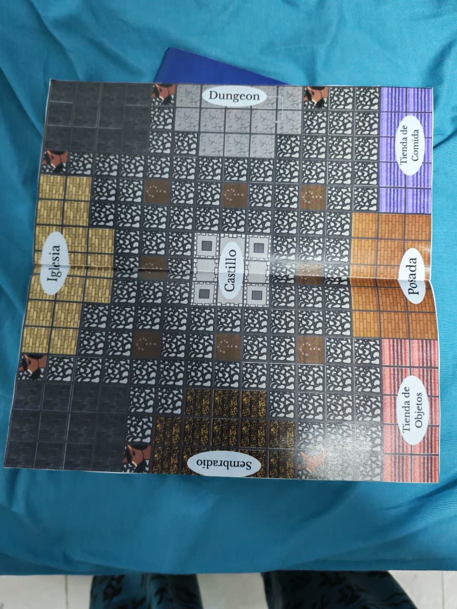
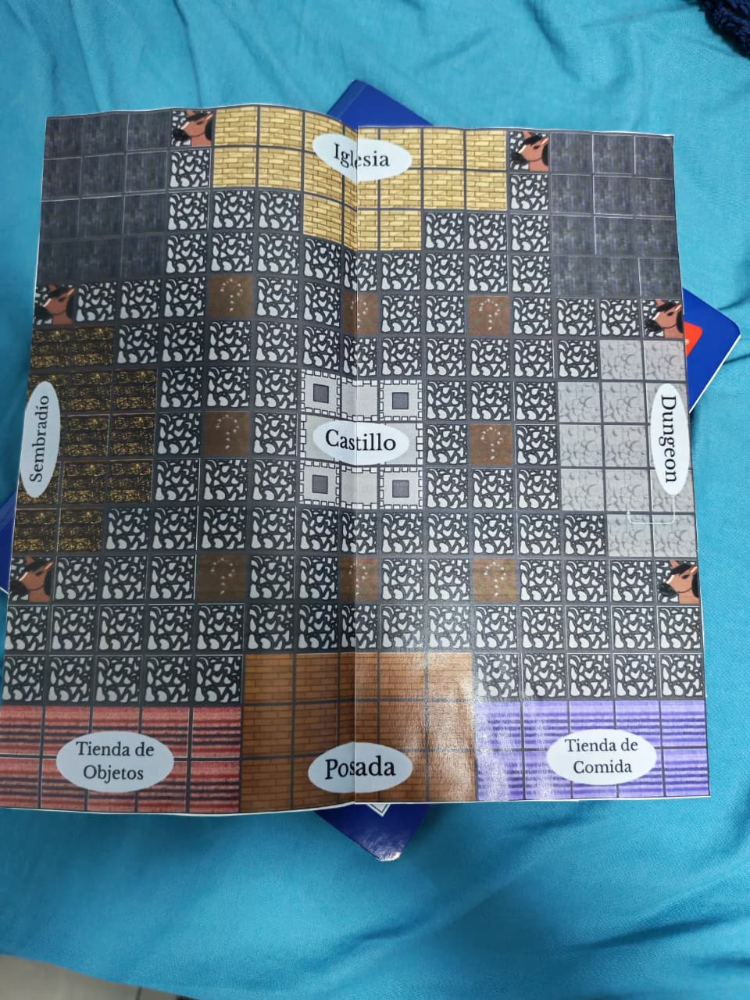
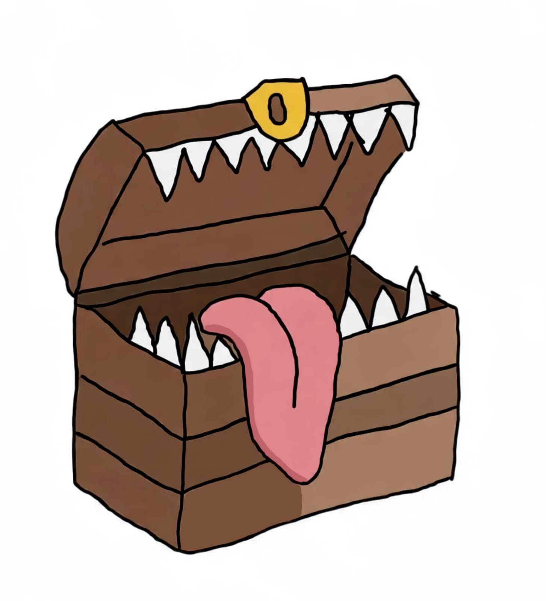
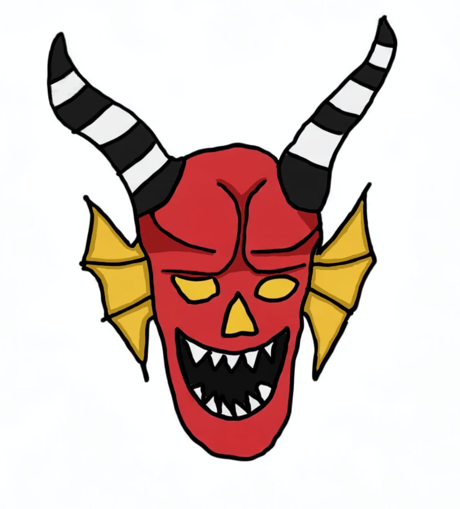
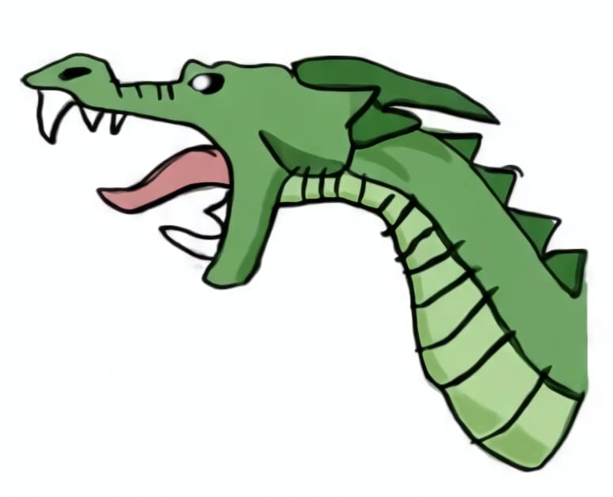
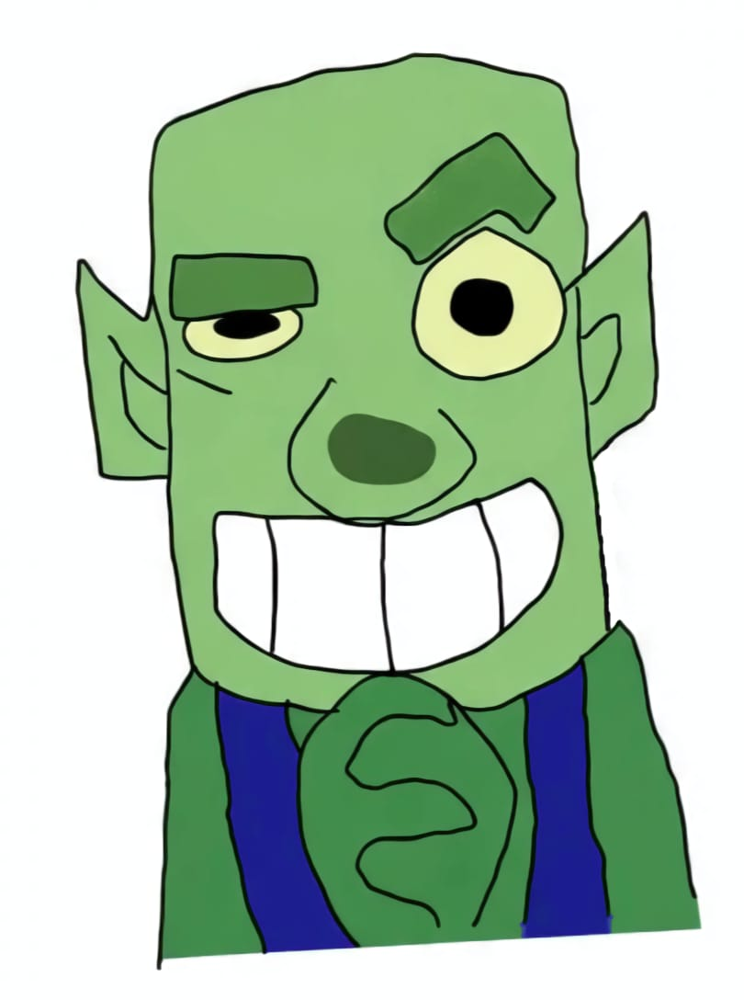
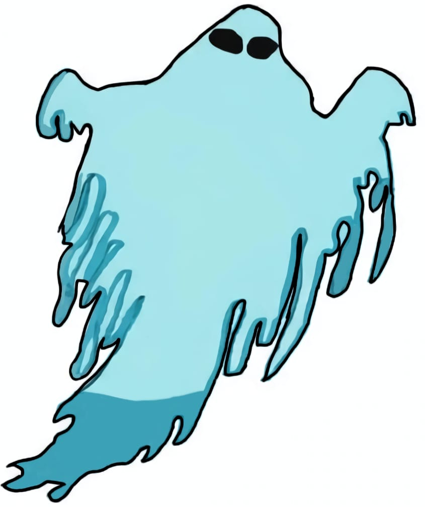
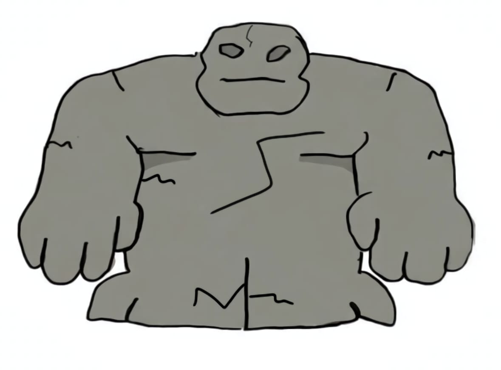
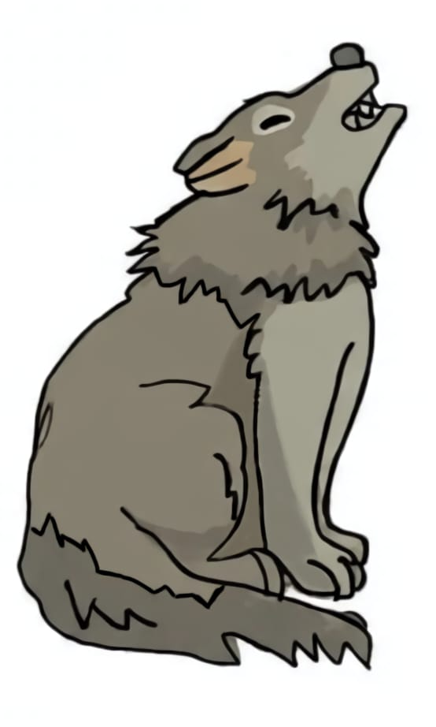
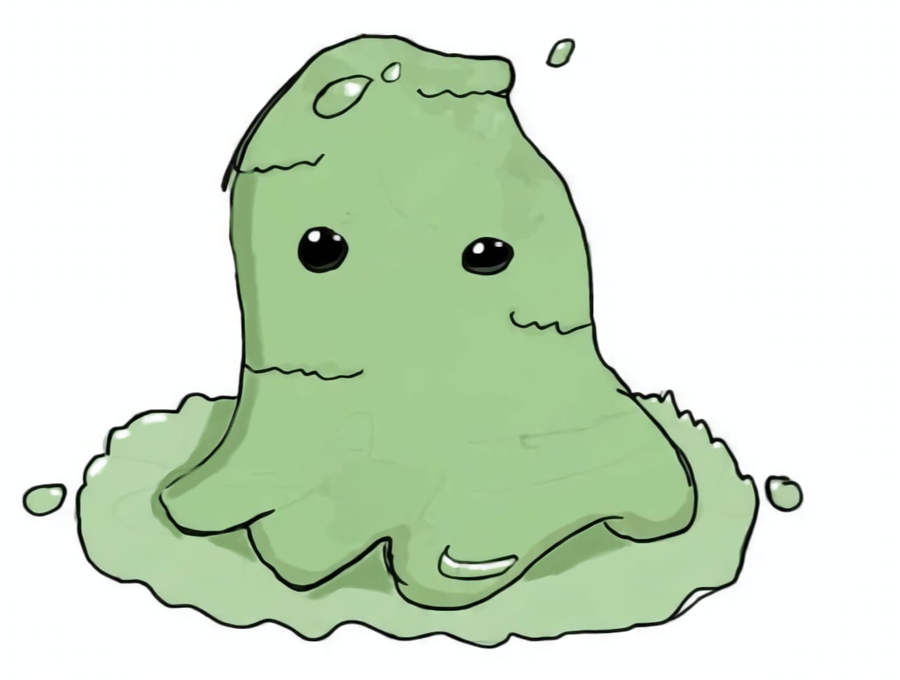

# Portafolio de Desarrollo y Diseño de Videojuegos
**Gerardo Israel Arreola Osorio**  
Estudiante de desarrollo y diseño de videojuegos, enfocado en programación en Unity (C#) y diseño de mecánicas de juego.

**Contacto:** `kabiyang3@gmail.com` | **Discord:** `kabiyang2026`

---

## Proyectos incluidos
* [1. Catcher Pato (Unity / C#)](#1-catcher-pato-unity--c)
* [2. Clicker My Game (Unity / C#)](#2-clicker-my-game-unity--c)
* [3. Juego de Cartas Estratégico (Game Design)](#3-juego-de-cartas-estratégico-game-design)
* [4. El Tributo del Hambre (Game Design)](#4-el-tributo-del-hambre-game-design)

---

## 1. Catcher Pato (Unity / C#)
* **Mi rol** Programación completa en C#, diseño de mecánicas, interfaz y fondos. *(Créditos: el diseño del pato fue hecho por Mónica Acedo).*
* **De qué trata** Un juego arcade infinito donde tienes que atrapar objetos que caen, cuidando tus vidas y buscando la puntuación más alta.
* **Decisiones de diseño** En lugar de hacer niveles con final, decidí dejarlo infinito para que el jugador intente superar su propio récord, usando colores distintos en las esferas para que se identifiquen rápido al caer y evitar confusiones.
* **Matemáticas aplicadas** Uso de números aleatorios (`Random.Range`) para generar los objetos en distintas posiciones del eje X, cálculo de caída en 2D y sumas/restas para el puntaje (+1 amarilla, +10 azul) y las vidas (5 al inicio, +1 verde, -1 roja o si se cae una buena).
* **Evidencias** *(Capturas del juego y scripts en C# pendientes por subir en la siguiente actualización).*
* **Qué aprendí** A programar colisiones en 2D (`OnTriggerEnter2D`), controlar el flujo de pantallas (inicio, juego y *Game Over*) y estructurar un ciclo de juego completo en Unity.

---

## 2. Clicker My Game (Unity / C#)
* **Mi rol** Proyecto individual (100% programación en C#, mecánicas e interfaz).
* **De qué trata** Un juego casual contrarreloj donde debes hacer la mayor cantidad de clics posibles antes de que se acabe el tiempo.
* **Decisiones de diseño** Ajusté las partidas para que duren 20 segundos, aunque puede aumentarse este límite si uno tiene suerte, y agregué un aumento en el valor del clic después de pasar los primeros 10 para darle más ritmo a la partida.
* **Matemáticas aplicadas** Uso de `Time.deltaTime` para llevar el conteo regresivo exacto, cálculo de probabilidades en cada clic para soltar bonos aleatorios (+10 puntos o +2 segundos extra) y multiplicadores simples (pasar de 1 a 2 puntos por clic al superar los 10 clicks).
* **Evidencias** *(Capturas de la interfaz y scripts del contador pendientes por subir en la siguiente actualización).*
* **Qué aprendí** A manejar temporizadores precisos en tiempo real y a programar eventos aleatorios que respondan rápido al jugador.

---

## 3. Juego de Cartas Estratégico (Game Design)
* **Mi rol** Diseño completo de las mecánicas, reglas y balanceo de mazos. *(Créditos: las ilustraciones conceptuales se apoyaron con herramientas de IA).*
* **De qué trata** Un juego de mesa competitivo de gestión de recursos y sabotear a los demás jugadores pensado para 2 a 4 jugadores (todos contra todos) o en equipos de 2 contra 2.
* **Decisiones de diseño** Después de hacer pruebas de juego (*playtesting*), tuve que cambiar efectos de cartas, rediseñar las reglas, rediseñar el tablero entre más cosas.
* **Matemáticas aplicadas** Balanceo de metas de victoria (juntar 12 recursos en individual o 20 en equipos, repartidos entre Oro y Elixir) y límite de acciones por turno (2 acciones: robar y jugar carta).
* **Evidencias** *(Fotos de las cartas impresas).*
* **Qué aprendí** A redactar reglas claras para que otros puedan jugar sin dudas y a ajustar efectos de cartas de cartas cuando algo queda muy fuerte para intentar balancearlo.

---

## 4. El Tributo del Hambre (Game Design)
* **Mi rol** Proyecto en equipo. Participé en la lluvia de ideas general del juego y me encargué **del diseño e ilustración de las cartas de enemigos de mazmorra (*dungeon*)**.
* **De qué trata** Un juego de mesa de supervivencia donde los jugadores administran comida, dinero y cordura mientras deciden como administraran su dinero y como obtendrán mas.
* **Decisiones de diseño** Dividimos las acciones del turno en opciones seguras (trabajar), opciones con riesgo medio (cultivar, que depende de qué tanta cordura tengas) y riesgo alto (entrar a la mazmorra a pelear).
* **Matemáticas aplicadas** Tiradas de dados para resolver combates contra enemigos, cobro periódico de impuestos (5 monedas cada 5 turnos) y conteo de desgaste (-1 de comida por turno, y si llega a 0 empieza a bajar la cordura).
* **Qué aprendí** A coordinarme en equipo repartiendo tareas claras y a diseñar enemigos que tuvieran sentido con la dificultad del tablero.

### Fotos del prototipo de tablero

| Vista general | Vista alterna |
| :---: | :---: |
|  |  |

### Diseño de enemigos (*Dungeon* — Dibujos propios)

| Bruja (Rediseño) | Bruja (Diseño anterior) | Cofre mímico | Demonio | Dragón |
| :---: | :---: | :---: | :---: | :---: |
|  |  |  |  |  |

| Duende| Espíritu | Gólem | Lobo | Slime |
| :---: | :---: | :---: | :---: | :---: |
|  |  |  |  |  |
